# AgentTally

<p>
  <a href="README.zh-CN.md">简体中文</a>
  &nbsp;|&nbsp;
  <a href="https://github.com/suiyun08/agenttally/releases/latest">Latest release</a>
  &nbsp;|&nbsp;
  <a href="LICENSE">MIT license</a>
</p>

**See which AI coding session needs you, right from the menu bar.**

AgentTally (代理指示) shows every Claude Code, Codex, opencode, pi, and DeepSeek Harness
session as a dot in your menu bar, grouped by agent. Rest the pointer on the dots to peek at
the panel, then click a session to jump back to its terminal tab, editor window, or desktop
thread.

<p>
  <a href="https://github.com/suiyun08/agenttally/releases/latest/download/AgentTally-macOS-arm64.dmg"><strong>Download for Apple Silicon</strong></a>
  &nbsp;|&nbsp;
  <a href="https://github.com/suiyun08/agenttally/releases/latest/download/AgentTally-macOS-x86_64.dmg">Intel</a>
</p>

<p align="center">
  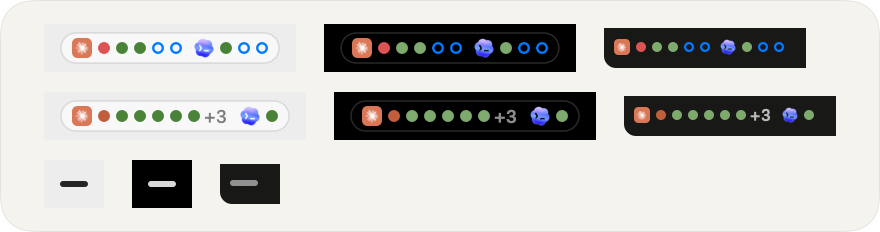
</p>

<p align="center">
  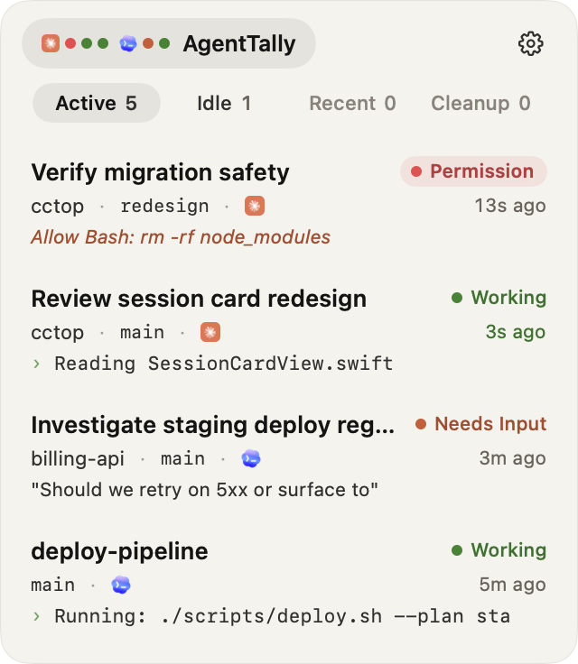
  &nbsp;
  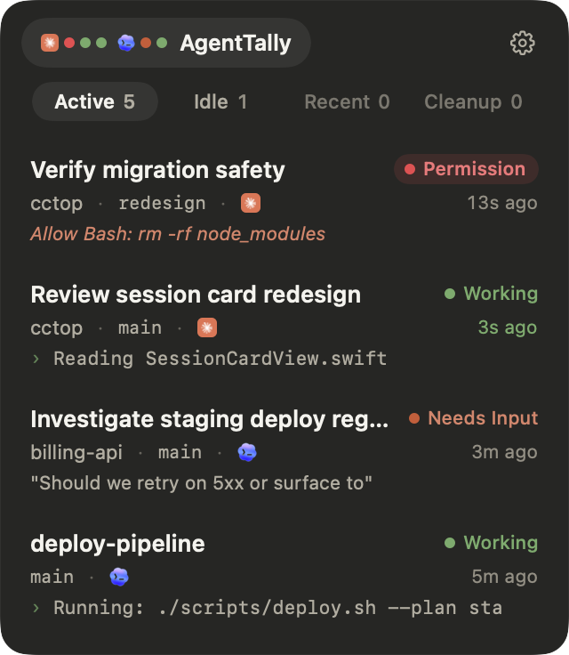
</p>

AgentTally started as a fork of [cctop](https://github.com/st0012/cctop) by Stan Lo and is now
developed on its own.

## What it does

- **Dots, grouped by agent.** One dot per session behind each agent's icon, colored by state:
  waiting for permission, waiting for your answer, or working, plus one for each finished result
  you have not read yet. Dots that wait on you breathe slowly between hollow and solid; working
  dots hold still. The dots sit on a small translucent pill so they stay readable
  over any wallpaper, and move beside the camera notch when the menu bar has no room.
- **Hover to peek.** Rest the pointer on the dots and the panel opens without taking keyboard
  focus from the app you are typing in. Move away and it closes, even after you click a session
  in it. Click the dots or press the toggle shortcut to keep the panel open. Turn hovering off in
  **Settings › General › Open on Hover**; the setting covers the floating indicator too.
- **Floating indicator.** Turn on **Settings › General › Floating Indicator** for the same dots on
  a small glass capsule you can drag anywhere. It shows on every desktop and over full-screen apps.
  It shows its floating notices the way the menu bar dots show the panel: rest the pointer on it,
  or click it to keep them out and click again to put them away.
- **Floating notices.** While the floating indicator is on, each session that is working, needs
  you, or has an unread result gets a small glass notice lined up with the capsule instead of a
  system banner. They show for 5 seconds when a session finishes, and stay out while a session
  waits for your permission or answer. Click one to jump to its session, or close it with ×. A
  notice stays until its session goes idle or is read, newest activity first, up to the number set
  in **Settings › General › Floating Notices**; "N more" shows the rest. They hold still while the
  pointer rests on them.
- **Tabs by attention.** **Active** holds sessions that are working or waiting for you, plus
  unread results. **Idle**, **Recent**, and **Cleanup** hold the rest.
- **Jump straight back.** Click a session card, or press the Navigate hotkey and a number, to go
  to the exact terminal pane, editor window, or desktop conversation.
- **Feishu bridge conversations.** Claude Code and Codex sessions that the Feishu bridge
  (`lark-channel-bridge`) runs for a Feishu chat stay listed between messages, keep an unread result
  until you open it, and open their Feishu topic when clicked.
- **Alerts you choose.** A notification when a session finishes (a floating notice while the
  floating indicator is on), and two separate sounds, one for "done" and one for "needs you". Each
  sound has its own setting, separate from notifications.
- **Read sync.** Reading a finished turn in Claude Desktop or Codex Desktop clears its unread dot
  here too.
- **A panel that fits your screen.** Liquid Glass on macOS 26 with white text that stays readable
  over any window, and a slider for how much theme color tints the glass. It shows on every
  desktop and opens under the menu bar dots. Drag a side edge to resize; it settles on three widths.
  Drag the top bar to move it while it is open; it snaps to screen edges. Double-click the top bar
  to put it back under the menu bar.
- **English and 简体中文**, and four color themes for the status and accent colors.
- **Local only.** Session state is plain JSON on your Mac. No analytics, telemetry, or upload.

## Works with your coding tools

<table>
  <tr>
    <td align="center" width="20%">
      <br>
      <strong>Claude Code / Desktop</strong><br><sub>Claude plugin + hooks</sub>
    </td>
    <td align="center" width="20%">
      <br>
      <strong>Codex CLI / Desktop</strong><br><sub>Codex hooks + trust step</sub>
    </td>
    <td align="center" width="20%">
      <br>
      <strong>DeepSeek Harness</strong><br><sub>DSH plugin</sub>
    </td>
    <td align="center" width="20%">
      <br>
      <strong>opencode</strong><br><sub>opencode plugin</sub>
    </td>
    <td align="center" width="20%">
      <br>
      <strong>pi</strong><br><sub>pi extension</sub>
    </td>
  </tr>
</table>

A Stream Deck plugin is also available under **Settings › Integrations**.

### Jump support

- **Exact session:** iTerm2, Warp, cmux, Kitty, Ghostty, Terminal, Codex Desktop, Herdr, Zellij,
  and tmux. AgentTally jumps to the right window, tab, pane, surface, or desktop thread.
- **Exact conversation:** Claude Desktop, through Claude's own continue link.
- **Project window:** VS Code, Cursor, Windsurf, and Zed, using the workspace file if present.
- **Anything else:** AgentTally brings the app to the front, or opens the project in Finder.

<details>
<summary>Focus details and requirements</summary>

- iTerm2, Ghostty, and Apple Terminal require macOS Automation permission.
- Kitty targets the exact window when `allow_remote_control socket-only` and `listen_on` are
  enabled in `kitty.conf`; otherwise it falls back to activating the app.
- Warp targets the exact pane through its session deep link, available since Warp v0.2026.05.27.
- Ghostty requires version 1.3.0 or later for AppleScript support.
- Apple Terminal targets the tab by tty. Inside tmux or screen it raises Terminal instead, because
  the captured tty belongs to the multiplexer pane.

</details>

## Navigate, recent projects, and cleanup

<table>
  <tr>
    <td width="42%">
      <h3>Navigate mode</h3>
      <p>Press a global hotkey to put numbers on every session card, then press <kbd>1</kbd> to <kbd>9</kbd> to jump.</p>
    </td>
    <td align="center">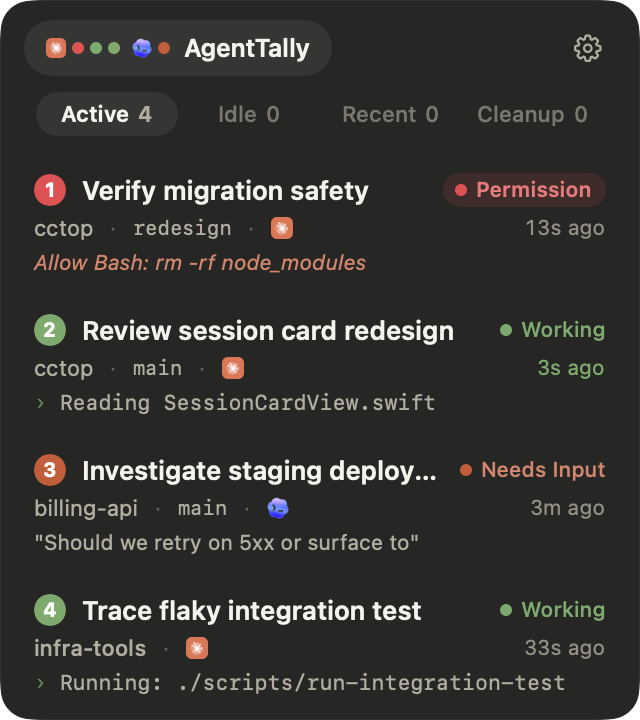</td>
  </tr>
  <tr>
    <td width="42%">
      <h3>Recent projects</h3>
      <p>Sessions from the last seven days, so you can reopen a project without hunting through old terminals.</p>
    </td>
    <td align="center">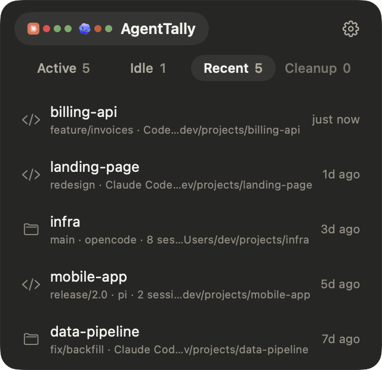</td>
  </tr>
  <tr>
    <td width="42%">
      <h3>Worktree cleanup</h3>
      <p>Finds worktrees that ended sessions left on disk, checks their Git state, and offers the right way to remove each one.</p>
    </td>
    <td align="center">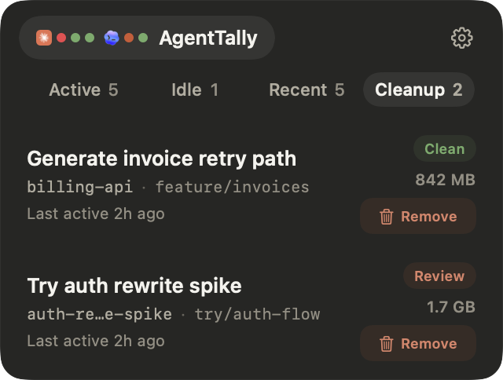</td>
  </tr>
</table>

## Install

### 1. Install the app

Download the DMG for your Mac and drag **AgentTally** into **Applications**:

- [Apple Silicon](https://github.com/suiyun08/agenttally/releases/latest/download/AgentTally-macOS-arm64.dmg)
- [Intel](https://github.com/suiyun08/agenttally/releases/latest/download/AgentTally-macOS-x86_64.dmg)

AgentTally runs on macOS 13 or later.

The app is not notarized by Apple yet, so macOS blocks it the first time you open it. Open
**System Settings › Privacy & Security** and click **Open Anyway**, or run:

```bash
xattr -dr com.apple.quarantine /Applications/AgentTally.app
```

### 2. Connect your tools

Open **Settings**. Under **Tools**, AgentTally shows a setup action for each coding tool it
finds:

- **Claude Code / Claude Desktop:** click **Copy Install Command** and run it in a terminal. It
  runs these two commands:

  ```bash
  claude plugin marketplace add suiyun08/agenttally
  ```

  ```bash
  claude plugin install cctop
  ```

- **Codex CLI / Codex Desktop:** click **Install Hooks**, then start a Codex CLI session and choose
  **Trust all and continue** when Codex reviews the hooks. Codex Desktop shares that trust.
- **DeepSeek Harness (DSH), opencode, and pi:** click **Install Plugin**. For DSH, AgentTally adds
  one marked row to `~/.dsh/cordis.patch.yml` and keeps a backup of the file next to it.
  **Remove** takes out only that row.
- **Stream Deck:** under **Integrations**, click **Install Plugin**.

Restart running sessions so they pick up the new hooks or plugins.

### Updating

Updates are not automatic yet. Watch this repository's releases, then download the new DMG and
replace the app in **Applications**.

### Coming from cctop

On first launch AgentTally copies your cctop settings: theme, language, panel width and position,
sounds, and shortcuts. macOS treats AgentTally as a new app, so turn **Launch at Login** on again,
and grant notification and Automation permission again when asked. Quit and delete `cctop.app`
so that only one app watches your sessions.

If your Claude Code plugin came from cctop's marketplace, switch it to this repository:

```bash
claude plugin marketplace remove cctop
```

Then run the two Claude commands above.

## Themes

Four palettes for the status and accent colors. Switch in **Settings › Appearance › Color**.

<table>
  <tr>
    <th align="center">Claude</th>
    <th align="center">Tokyo Night</th>
    <th align="center">Gruvbox</th>
    <th align="center">Nord</th>
  </tr>
  <tr>
    <td align="center">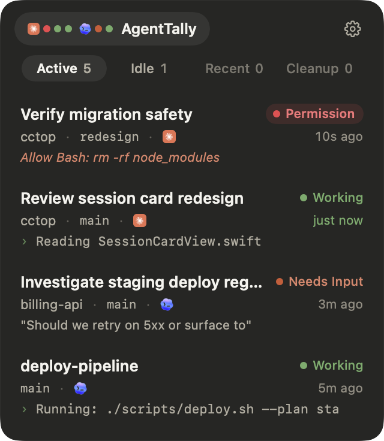</td>
    <td align="center">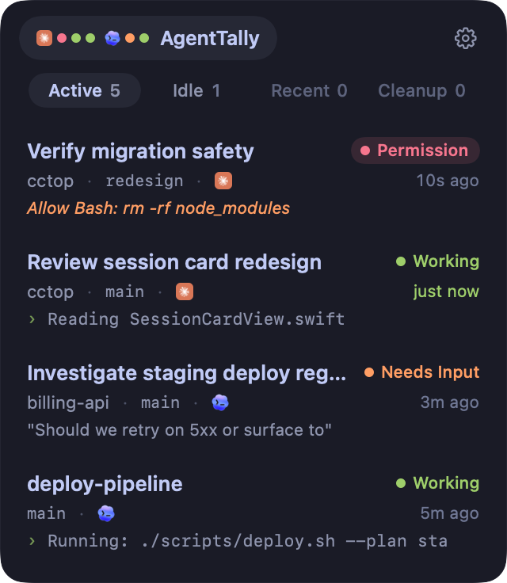</td>
    <td align="center">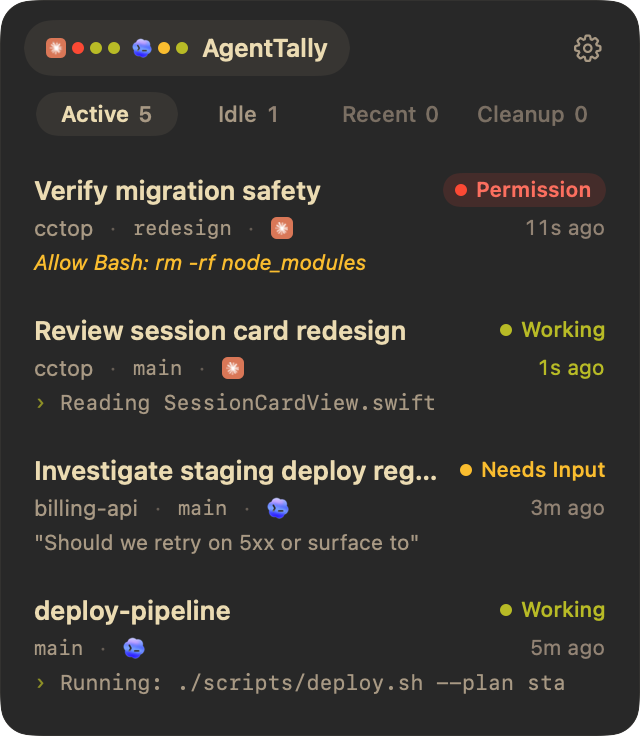</td>
    <td align="center">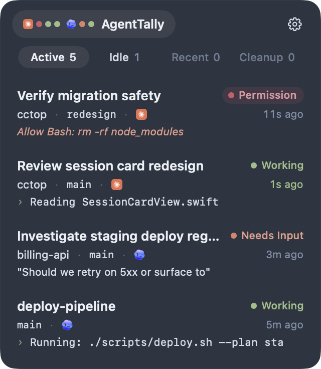</td>
  </tr>
</table>

## Privacy

**No analytics, no telemetry, and no session upload.** Session data stays on your Mac in
`~/.cctop/sessions/` as plain JSON. The release builds make no network requests of their own.

AgentTally also writes `~/.cctop/display-state.json` for display integrations such as Stream
Deck. Each entry holds only the session's display name, status, and color.

<details>
<summary>What AgentTally stores</summary>

- Session status, such as working, waiting, or done.
- The project directory name.
- The last activity time.
- The current tool or prompt context.

Inspect the files any time:

```bash
ls ~/.cctop/sessions/
```

The fields are documented in [`docs/session-files.md`](docs/session-files.md).

</details>

## FAQ

<details>
<summary>No sessions are showing up. What do I check?</summary>

Restart sessions after installing a plugin or hooks. Then check whether session files exist:

```bash
ls ~/.cctop/sessions/
```

If the folder is empty, the integration is not writing yet. If files exist but nothing shows,
check whether those files have `"hidden": true`, then restart AgentTally.

</details>

<details>
<summary>Does AgentTally slow down my coding tool?</summary>

No. Each integration calls a small native helper, `cctop-hook`, which writes one small JSON file
and returns.

</details>

<details>
<summary>Why does Codex need an extra trust step?</summary>

Codex runs only hooks you have reviewed and trusted. Codex Desktop does not show that review
prompt, so trust the hooks once in a Codex CLI session; Codex Desktop shares that trust.

</details>

<details>
<summary>Why does the app need to live in Applications?</summary>

Plugins look for `cctop-hook` inside `/Applications/AgentTally.app`,
`~/Applications/AgentTally.app`, or `~/.cctop/bin/`. Installing elsewhere breaks that path.

</details>

<details>
<summary>Why are the files and plugins still called cctop?</summary>

AgentTally keeps cctop's internal names (`~/.cctop`, `cctop-hook`, the `cctop` Claude plugin,
`cctop://` links) so existing setups keep working.

</details>

## Reference

<details>
<summary>How it works</summary>

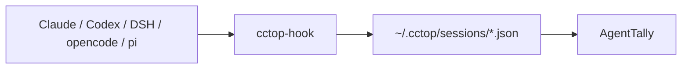

1. A plugin or hook in each tool turns its events into `cctop-hook` calls.
2. `cctop-hook` writes one small JSON file per session.
3. AgentTally watches `~/.cctop/sessions/` and shows live status.

</details>

<details>
<summary>Uninstall</summary>

Remove plugins from **Settings › Tools** first, so AgentTally can take out its DSH row and Codex
hooks cleanly. Then:

```bash
rm -rf /Applications/AgentTally.app
claude plugin uninstall cctop
claude plugin marketplace remove cctop
rm -rf ~/.cctop
```

</details>

<details>
<summary>Build from source</summary>

Requires Xcode 26 or later.

```bash
git clone https://github.com/suiyun08/agenttally.git
cd agenttally
./scripts/bundle-macos.sh
cp -R dist/AgentTally.app /Applications/
open /Applications/AgentTally.app
```

</details>

## Trademarks

Claude, Codex, DeepSeek, opencode, pi, Stream Deck, and the other product names and logos here
belong to their owners and are used only to identify the tools AgentTally works with. AgentTally
is not affiliated with or endorsed by Anthropic, OpenAI, DeepSeek, or any other tool vendor.

## License

[MIT](LICENSE). cctop is © Stan Lo; AgentTally's changes are © suiyun08.
