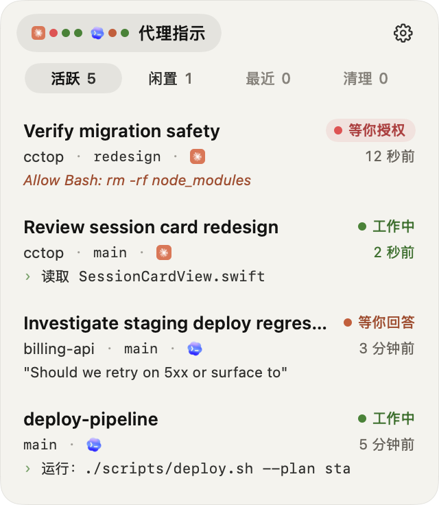
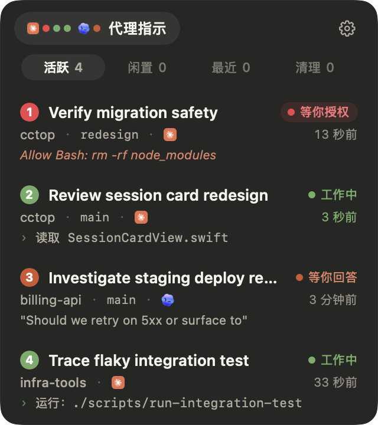
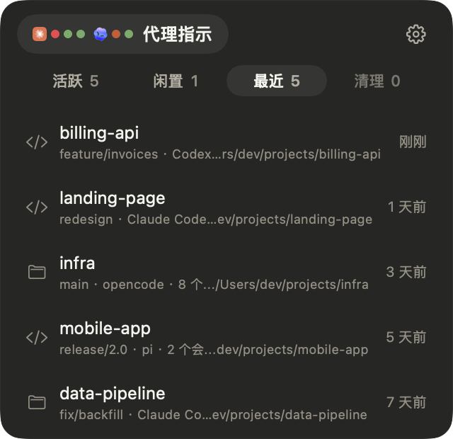
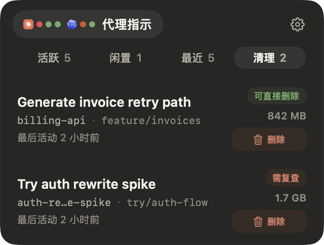
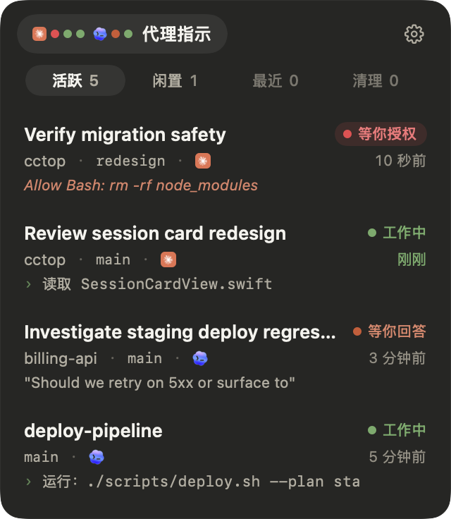
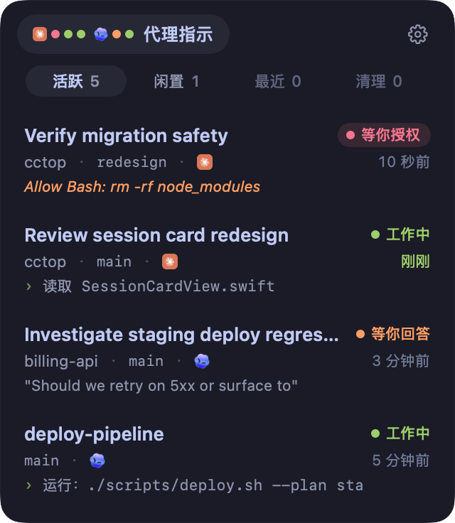
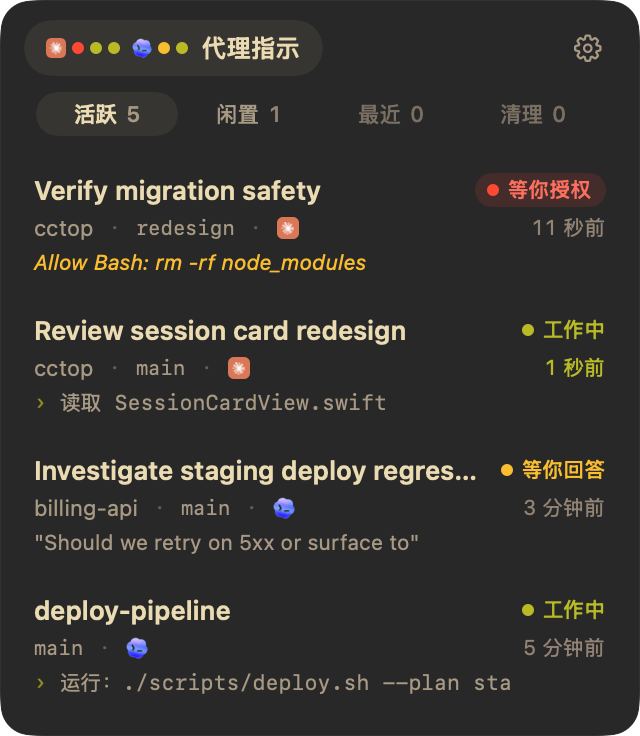
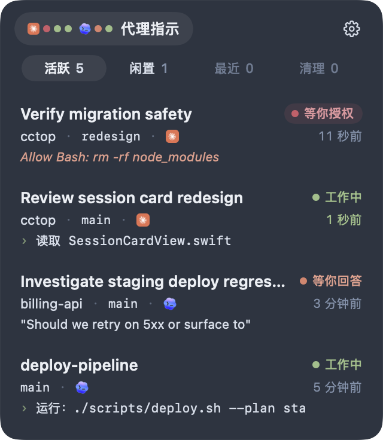
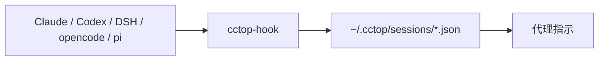

# 代理指示（AgentTally）

<p>
  <a href="README.md">English</a>
  &nbsp;|&nbsp;
  <a href="https://github.com/suiyun08/agenttally/releases/latest">最新版本</a>
  &nbsp;|&nbsp;
  <a href="LICENSE">MIT 许可证</a>
</p>

**在菜单栏上一眼看出哪个 AI 编程会话在等你。**

代理指示把 Claude Code、Codex、opencode、pi 和 DeepSeek Harness 的每个会话都显示成菜单栏上的一个圆点，
按 agent 分组。鼠标停在圆点上就能展开面板；点一下会话，直接跳回它所在的终端标签页、编辑器窗口或桌面版对话。

<p>
  <a href="https://github.com/suiyun08/agenttally/releases/latest/download/AgentTally-macOS-arm64.dmg"><strong>下载 Apple 芯片版</strong></a>
  &nbsp;|&nbsp;
  <a href="https://github.com/suiyun08/agenttally/releases/latest/download/AgentTally-macOS-x86_64.dmg">Intel 版</a>
</p>

<p align="center">
  
</p>

<p align="center">
  
</p>

代理指示最初基于 Stan Lo 的 [cctop](https://github.com/st0012/cctop)，现在独立开发。

## 能做什么

- **按 agent 分组的指示灯**：每个会话一个圆点，排在对应 agent 的图标后面，颜色表示状态：等你授权、等你回答、
  工作中，还没看的已完成结果也各有一个圆点。等你处理的圆点会在空心和实心之间缓慢呼吸，工作中的圆点保持静止。
  圆点下面垫了一层半透明胶囊，任何壁纸上都看得清；
  菜单栏放不下时，会显示在摄像头刘海旁边。
- **悬停展开**：鼠标停在指示灯上，面板展开，但不会抢走你正在打字的应用的键盘焦点；移开后自动收起，
  在面板里点过会话也一样。点击指示灯或按快捷键打开的面板会常驻。可在「设置 › 通用 › 悬停展开」关闭。
- **悬浮指示灯**：打开「设置 › 通用 › 悬浮指示灯」，同样的指示灯会显示在一个可以拖到任意位置的玻璃小胶囊里。
  所有桌面和全屏应用上都能看到；鼠标移上去面板立即展开，点一下面板就常驻。
- **浮窗提醒**：悬浮指示灯开着时，工作中、等你处理或有未读结果的会话，会在胶囊下方各显示一个玻璃小浮窗，代替系统通知。
  点浮窗跳到对应会话，点 × 关闭。会话闲置或已读后浮窗自动消失；最近有交互的排在前面，
  最多显示几条在「设置 › 通用 › 浮窗显示上限」里调。整组浮窗可以一起拖到任意位置。
- **按注意力分页**：「活跃」放工作中、等你处理的会话和未读结果；「闲置」「最近」「清理」放其余的。
- **一键跳回**：点会话卡片，或按导航快捷键再按数字，直接跳到对应的终端窗格、编辑器窗口或桌面版对话。
- **提醒可自选**：会话完成时发通知（悬浮指示灯开着时改为浮窗）；「任务完成」和「等你回复」两种提示音各自可选，并且和通知分开设置。
- **已读同步**：在 Claude 桌面版或 Codex 桌面版里看过的结果，这里的未读标记会自动清掉。
- **面板随你调**：macOS 26 上是液态玻璃，白色文字在任何窗口上方都看得清，滑杆可以调玻璃上叠加多少主题色。
  面板在所有桌面上都显示。拖左右边缘调宽度，会吸附到三档宽度；拖顶栏移动位置，会自动贴住屏幕边缘；
  双击顶栏回到菜单栏下方。
- **简体中文和英文界面**，四套配色，决定状态色和强调色。
- **只在本机**：会话状态以 JSON 文件存在你的 Mac 上，没有统计、遥测或上传。

## 支持的编程工具

<table>
  <tr>
    <td align="center" width="20%">
      <br>
      <strong>Claude Code / 桌面版</strong><br><sub>Claude 插件 + hooks</sub>
    </td>
    <td align="center" width="20%">
      <br>
      <strong>Codex CLI / 桌面版</strong><br><sub>Codex hooks + 信任确认</sub>
    </td>
    <td align="center" width="20%">
      <br>
      <strong>DeepSeek Harness</strong><br><sub>DSH 插件</sub>
    </td>
    <td align="center" width="20%">
      <br>
      <strong>opencode</strong><br><sub>opencode 插件</sub>
    </td>
    <td align="center" width="20%">
      <br>
      <strong>pi</strong><br><sub>pi 扩展</sub>
    </td>
  </tr>
</table>

「设置 › 集成」里还有 Stream Deck 插件。

### 跳转支持

- **精确到会话**：iTerm2、Warp、cmux、Kitty、Ghostty、终端、Codex 桌面版、Herdr、Zellij、tmux。
  会跳到对应的窗口、标签页、窗格或桌面版对话。
- **精确到对话**：Claude 桌面版，通过 Claude 自己的继续对话链接打开。
- **打开项目窗口**：VS Code、Cursor、Windsurf、Zed，有工作区文件时用工作区文件打开。
- **其他情况**：把对应应用切到最前面，或在访达里打开项目文件夹。

<details>
<summary>跳转细节与要求</summary>

- iTerm2、Ghostty 和「终端」需要 macOS 的自动化（终端控制）权限。
- Kitty 需要在 `kitty.conf` 里开启 `allow_remote_control socket-only` 和 `listen_on`，否则只会把 Kitty 切到前面。
- Warp 通过会话深链接定位窗格，需要 Warp v0.2026.05.27 或更新版本。
- Ghostty 需要 1.3.0 或更新版本。
- 「终端」按 tty 定位标签页；在 tmux 或 screen 里时只会把「终端」切到前面。

</details>

## 导航、最近项目与清理

<table>
  <tr>
    <td width="42%">
      <h3>导航模式</h3>
      <p>按全局快捷键，每张会话卡片都会标上数字，再按 <kbd>1</kbd> 到 <kbd>9</kbd> 直接跳过去。</p>
    </td>
    <td align="center"></td>
  </tr>
  <tr>
    <td width="42%">
      <h3>最近项目</h3>
      <p>保留最近 7 天的会话，不用在旧终端里翻找就能重新打开项目。</p>
    </td>
    <td align="center"></td>
  </tr>
  <tr>
    <td width="42%">
      <h3>清理 worktree</h3>
      <p>找出已结束会话留在磁盘上的 worktree，先检查 Git 状态，再给出合适的删除方式。</p>
    </td>
    <td align="center"></td>
  </tr>
</table>

## 安装

### 1. 安装应用

下载对应芯片的 DMG，把 **AgentTally** 拖进「应用程序」：

- [Apple 芯片](https://github.com/suiyun08/agenttally/releases/latest/download/AgentTally-macOS-arm64.dmg)
- [Intel](https://github.com/suiyun08/agenttally/releases/latest/download/AgentTally-macOS-x86_64.dmg)

需要 macOS 13 或更新版本。

这个应用暂时没有经过 Apple 公证，第一次打开会被系统拦下。到「系统设置 › 隐私与安全性」点「仍要打开」，
或者在终端运行：

```bash
xattr -dr com.apple.quarantine /Applications/AgentTally.app
```

### 2. 连接你的编程工具

打开「设置」。「工具」里会给检测到的每个编程工具显示一个安装按钮：

- **Claude Code / Claude 桌面版**：点「复制安装命令」，在终端里运行。它会执行下面两条命令：

  ```bash
  claude plugin marketplace add suiyun08/agenttally
  ```

  ```bash
  claude plugin install cctop
  ```

- **Codex CLI / Codex 桌面版**：点「安装 Hooks」，然后开一个 Codex CLI 会话，在 Codex 审查 hooks 时选
  **Trust all and continue**。Codex 桌面版共用这份信任设置。
- **DeepSeek Harness（DSH）、opencode 和 pi**：点「安装插件」。DSH 的安装会在 `~/.dsh/cordis.patch.yml`
  里加一行带标记的配置，并在旁边保留原文件的备份；点「删除」只会去掉这一行。
- **Stream Deck**：在「集成」里点「安装插件」。

装好后重启正在运行的会话，让它们加载新的 hooks 或插件。

### 更新

暂不支持自动更新。关注本仓库的 Release，有新版本时下载新的 DMG，替换「应用程序」里的旧版即可。

### 从 cctop 迁移过来

代理指示第一次启动时会沿用 cctop 的设置：配色、语言、面板宽度和位置、提示音、快捷键。macOS 会把它当成
一个新应用，所以需要重新打开「登录时启动」，并在系统询问时重新授予通知和自动化权限。
请退出并删除 `cctop.app`，避免两个应用同时监视会话。

如果你的 Claude Code 插件来自 cctop 的插件市场，先把它换成本仓库：

```bash
claude plugin marketplace remove cctop
```

然后再运行上面两条 Claude 命令。

## 配色

四套配色，决定状态色和强调色。在「设置 › 外观 › 配色」里切换。

<table>
  <tr>
    <th align="center">Claude</th>
    <th align="center">Tokyo Night</th>
    <th align="center">Gruvbox</th>
    <th align="center">Nord</th>
  </tr>
  <tr>
    <td align="center"></td>
    <td align="center"></td>
    <td align="center"></td>
    <td align="center"></td>
  </tr>
</table>

## 隐私

**没有统计、没有遥测、不上传会话。** 会话数据以 JSON 文件存在你的 Mac 上的 `~/.cctop/sessions/` 里。
发布版本自身不发起任何网络请求。

代理指示还会写 `~/.cctop/display-state.json` 给 Stream Deck 这类显示插件用，每条只包含会话的显示名称、状态和颜色。

<details>
<summary>代理指示存了什么</summary>

- 会话状态，比如工作中、等待中、已完成。
- 项目文件夹名称。
- 最后活动时间。
- 当前正在用的工具或提示内容。

随时可以查看：

```bash
ls ~/.cctop/sessions/
```

字段说明见 [`docs/session-files.md`](docs/session-files.md)。

</details>

## 常见问题

<details>
<summary>面板里一个会话都没有，怎么排查？</summary>

装完插件或 hooks 后先重启会话，再看会话文件是否存在：

```bash
ls ~/.cctop/sessions/
```

文件夹是空的，说明集成还没开始写数据；有文件但面板里没有，看看这些文件里是不是 `"hidden": true`，然后重启代理指示。

</details>

<details>
<summary>会拖慢我的编程工具吗？</summary>

不会。每次会话事件只调用一个很小的本地程序 `cctop-hook`，写一个小 JSON 文件就返回。

</details>

<details>
<summary>为什么 Codex 要多一步信任确认？</summary>

Codex 只运行你审查并信任过的 hooks。Codex 桌面版不会弹出这个审查提示，所以要在 Codex CLI 里信任一次，桌面版共用这份信任设置。

</details>

<details>
<summary>为什么应用必须放在「应用程序」里？</summary>

插件会在 `/Applications/AgentTally.app`、`~/Applications/AgentTally.app` 或 `~/.cctop/bin/` 里找 `cctop-hook`，放在别处会找不到。

</details>

<details>
<summary>为什么文件和插件还叫 cctop？</summary>

代理指示保留了 cctop 的内部名称（`~/.cctop`、`cctop-hook`、Claude 插件名 `cctop`、`cctop://` 链接），这样原有的配置可以继续用。

</details>

## 参考

<details>
<summary>工作原理</summary>



1. 每个工具里的插件或 hook 把事件转成对 `cctop-hook` 的调用。
2. `cctop-hook` 为每个会话写一个小 JSON 文件。
3. 代理指示监视 `~/.cctop/sessions/`，实时显示状态。

</details>

<details>
<summary>卸载</summary>

先在「设置 › 工具」里删除各个插件，这样代理指示能干净地移除 DSH 配置行和 Codex hooks。然后：

```bash
rm -rf /Applications/AgentTally.app
claude plugin uninstall cctop
claude plugin marketplace remove cctop
rm -rf ~/.cctop
```

</details>

<details>
<summary>从源码构建</summary>

需要 Xcode 26 或更新版本。

```bash
git clone https://github.com/suiyun08/agenttally.git
cd agenttally
./scripts/bundle-macos.sh
cp -R dist/AgentTally.app /Applications/
open /Applications/AgentTally.app
```

</details>

## 商标说明

Claude、Codex、DeepSeek、opencode、pi、Stream Deck 等产品名称和标志归各自所有者所有，这里只用来标明
代理指示支持哪些工具。代理指示与 Anthropic、OpenAI、DeepSeek 或其他工具厂商没有隶属或背书关系。

## 许可证

[MIT](LICENSE)。cctop 版权归 Stan Lo 所有；代理指示的改动版权归 suiyun08 所有。
